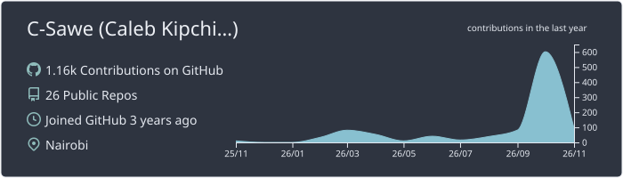
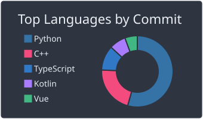
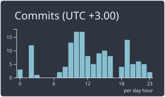

**BSc Informatics & Computer Science · Strathmore University, Nairobi**

 

## About

Final-year Informatics & Computer Science student and software engineer specialising in **applied reinforcement learning**, **MLOps/RLOps infrastructure**, and **full-stack distributed systems**.

I work on the gap between experimental models and resilient, high-throughput production systems: from automated continuous-training pipelines for financial markets to enterprise ERP and FinTech platforms running in production.

 

## Featured Engineering

<table>
  <tr>
    <td width="33%" valign="top">
      <h4>Deep RL Trading &amp; RLOps</h4>
      <b>Thesis</b>
      
PPO-based portfolio management for global energy equities. A <b>Prefect</b>-driven Continuous Training orchestrator detects alpha decay and triggers regime-aware retraining, with live telemetry served through <b>FastAPI</b>, <b>PostgreSQL</b> and a <b>React</b> dashboard.

    </td>
    <td width="33%" valign="top">
      <h4>Enterprise ERP &amp; FinTech</h4>
      <b>Production</b>
      
Agricultural e-commerce and inventory systems built on <b>Laravel</b>, <b>React</b>, <b>Inertia.js</b> and <b>MySQL</b>, with automated <b>M-Pesa STK Push</b> payments and custom <b>C# COM</b> POS hooks for real-time KRA eTIMS (VSCU) tax compliance.

    </td>
    <td width="33%" valign="top">
      <h4>Systems &amp; Distributed Computing</h4>
      <b>Infrastructure</b>
      
Containerised HTTP load balancers using consistent hashing with quadratic probing, interactive 3D and geospatial visualisers (<code>react-globe.gl</code>), and embedded IoT telemetry systems.

    </td>
  </tr>
</table>

 

## Technical Stack

<table>
  <tr>
    <td width="22%"><b>Languages</b></td>
    <td>
      
      
      
      
      
      
      
    </td>
  </tr>
  <tr>
    <td><b>Frameworks</b></td>
    <td>
      
      
      
      
      
      
      
      
    </td>
  </tr>
  <tr>
    <td><b>AI, Deep RL &amp; MLOps</b></td>
    <td>
      
      
      
      
      
    </td>
  </tr>
  <tr>
    <td><b>Data &amp; Infrastructure</b></td>
    <td>
      
      
      
      
      
    </td>
  </tr>
</table>

 

## GitHub Telemetry · 2026

  

  
  &nbsp;
  

  
  &nbsp;
  

Cards are generated daily by GitHub Actions and served from this repository.

 

## Reach Out

Open to **research collaborations** in quantitative RL and MLOps, technical discussions on **resilient backend systems**, and **software / AI engineering roles**.

  
  

